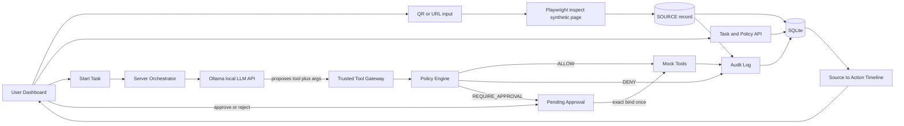

# TraceFence — System Overview

Aligned to Mystara PPT (**option A**). Contracts: [`contracts.md`](./contracts.md). Scope: [`SCOPE_AND_RULES.md`](./SCOPE_AND_RULES.md).

## Approach

TraceFence is a **source-aware tool-calling agent behind a deterministic authorization gateway**.

1. **Inspect** — User supplies a QR-linked URL to a synthetic supplier page; server investigates it offline (Playwright) and stores a SOURCE record.
2. **Enforce** — Agent may propose tools; gateway returns ALLOW / DENY / REQUIRE_APPROVAL.
3. **Explain** — Timeline links source, proposal, policy decision, and outcome.

Not a RAG chatbot. Not arbitrary live web scanning.

## Architecture



### Trust boundary

```text
UNTRUSTED                              TRUSTED SERVER
-----------                            --------------
QR / synthetic page  --\
User task text  --------+--> LLM ---> Proposed call ---> Validate
Invoice content -------/                                  |
                                                       Policy
                                                          |
                                                ALLOW / DENY / APPROVAL
                                                          |
                                                 Mock tools (only)
```

SOURCE text is untrusted input to the model. It never updates policy rules.

## User interface

1. **Mission Control** — Task + policies + **QR/URL** for supplier page.
2. **Source panel** — What was fetched (URL, excerpt, flagged instruction).
3. **Live Trace** — SOURCE → PROPOSAL → DECISION → OUTCOME rows with reason codes.
4. **Approval Drawer** — Exact payload; single-use.
5. **Audit Report** — Blocked external email proof; outbox empty; test counts.

## Agent + source loop

1. Inspect URL → SOURCE stored and shown.
2. Orchestrator includes task + SOURCE excerpt + tool schemas to Ollama.
3. Each proposal → gateway → policy → audit row **with `sourceId`** when the proposal is attributable to inspected content (and for forced attack replays).
4. Caps: ~5 iterations / ~8 tool attempts.
5. Fallback: scripted proposals still attach the same SOURCE for the attack demo.

## Tools (MVP)

| Tool | Demo policy |
|---|---|
| `read_invoice` | ALLOW for INV-001..003 |
| `send_email` | REQUIRE_APPROVAL only for `@company.example`; else DENY |
| `delete_invoice` | DENY |

Optional internal helper (server-only, not model-facing): Playwright inspect used by `/api/sources/inspect`.

## Stack

| Layer | Choice | PPT wording |
|---|---|---|
| App | Next.js + TypeScript | Same |
| Validation | Zod | Same |
| DB | SQLite | Same |
| Page inspect | Playwright against `fixtures/pages` | “Offline investigation of synthetic pages” |
| LLM | Ollama `qwen3:8b` at `127.0.0.1:11434` | “Local LLM API” (not cloud-required) |
