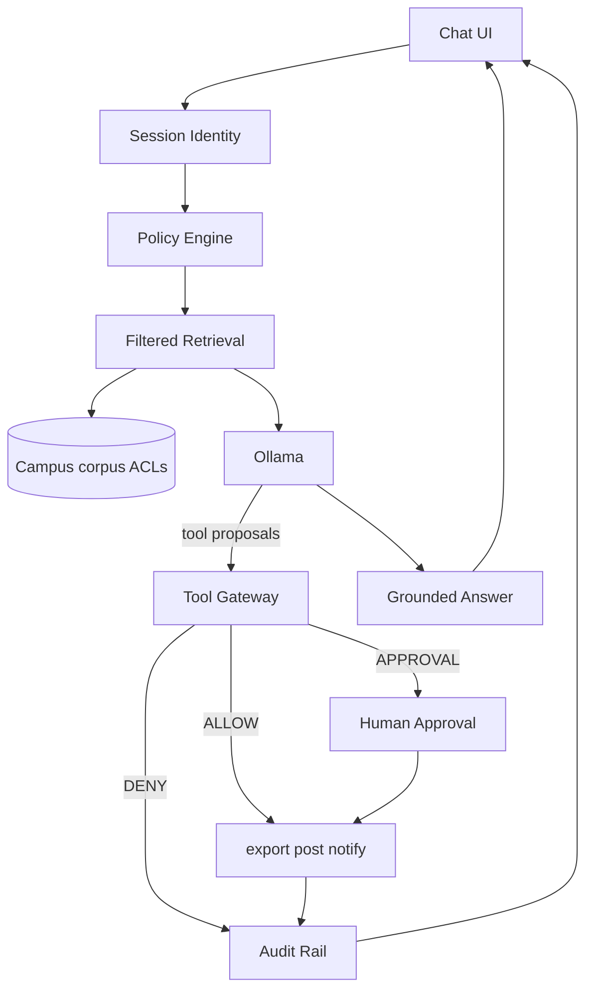

# TraceFence — System Overview

**TraceFence** — *A source-aware security gateway for AI agents*  
Original product: filter sources + authorize **multiple** tools (not email-only).  
Hackathon demo surface: campus chat + filtered retrieval + tool gateway.

## Request flow

```text
User (chat)
  ↓
Session identity (role, tenant=nulltrace-institute)
  ↓
Authorization / Policy Engine     ← what collections & tools?
  ↓
Permission-Filtered Chunk RAG     ← ACL first, then top-k excerpts only
  ↓
LLM (Ollama)                      ← only allowed chunks (not full PDFs)
  ↓
Tool proposals (if any)
  ↓
Trusted Tool Gateway              ← ALLOW / DENY / REQUIRE_APPROVAL
  ↓
Output (answer + decision rail + audit)
```

**Bad design we explicitly reject:** retrieve everything → prompt “don’t reveal secrets.”

## User interaction

1. Pick role: Student / Faculty / Admin.  
2. Ask in chat (campus questions).  
3. System retrieves **only** allowed docs, then answers.  
4. If a sensitive **action** is proposed (export, external notify), gateway decides; user may Approve once.  
5. Decision rail shows retrieval/tool outcomes and reason codes.

## Architecture



## Campus demo ACLs

| Role | Public handbook | Confidential directory / grades | export_records |
|---|---|---|---|
| student | retrieve ALLOW | retrieve DENY (never in context) | DENY |
| faculty | ALLOW | ALLOW or limited | REQUIRE_APPROVAL |
| admin | ALLOW | ALLOW | ALLOW or APPROVAL |

Exact ACLs: `fixtures/campus/policies/`.

## Layers

| Layer | Contents |
|---|---|
| Gateway core | Identity session, policy eval, filtered search API, tool gateway, audit, LLM adapter |
| Campus demo | Roles, doc classifications, tool matrix, prompts, fixtures |

## Stack

Next.js + TS + Zod + SQLite + Ollama. Retrieval: keyword/ACL over `fixtures/campus/` first; vectors P1.
