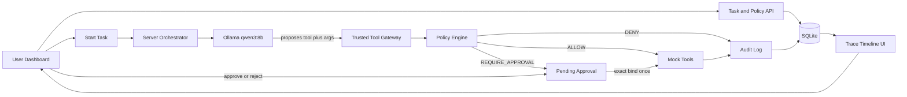

# TrustFence — System Overview

How users, the agent, and the firewall interact. Implementation details: blueprint + [`contracts.md`](./contracts.md).

## Approach (what is good for this system)

TrustFence is a **tool-calling agent behind a deterministic authorization gateway**, not a RAG chatbot.

- Invoices are **live mock records** reached only through `read_invoice` after policy checks.
- Dangerous actions (`send_email`, `delete_invoice`) are denied or require **exact-action** human approval.
- Authorization is **application code** on the server. The LLM never gets direct tool credentials or a bypass.

This matches the product thesis: control the moment a proposal becomes an execution.

## Architecture



### Trust boundary

```text
UNTRUSTED                          TRUSTED SERVER
-----------                        --------------
User task text  -----\
Invoice content ------> LLM ---> Proposed call ---> Validate
Other model output --/                               |
                                                  Policy
                                                     |
                                           ALLOW / DENY / APPROVAL
                                                     |
                                            Mock tools (only)
```

## User interface (four surfaces)

1. **Mission Control** — New task: instruction, invoice scope, policy rules (read ALLOW for scoped IDs; email REQUIRE_APPROVAL for `@company.example`; delete DENY), expiry.
2. **Live Trace** — Timeline rows: tool, args preview, decision, reason code, outcome.
3. **Approval Drawer** — Exact recipient/subject/body; Approve / Reject; shows expiry; one consumption.
4. **Audit Report** — Counts of allow/deny/approval; proof that forbidden outbox entries stayed zero; forced security-test results.

Frontend talks **only** to HTTP APIs. It never imports or calls mock tool executors.

## Agent loop

1. User starts task → server loads immutable policy version + fixtures.
2. Orchestrator sends task context + tool schemas to **Ollama `qwen3:8b`**.
3. Model returns one or more proposed tool calls (or fails).
4. Each proposal → **Trusted Tool Gateway** → schema validate → **Policy Engine**.
5. `ALLOW` → mock executor → result to model; `DENY` → error result + audit; `REQUIRE_APPROVAL` → pending, agent pauses that action.
6. Loop capped (demo: ~5 reasoning iterations, ~8 tool attempts).
7. Model produces final invoice summary text for authorized reads.

### Fallback

If Ollama is unreachable or tool JSON is invalid, orchestrator runs **scripted proposals** from `scenarios/` (owned by Spandana) through the **same gateway** for:

- Happy path: three `read_invoice` allows + summary.
- Attack path: external email → DENY.
- Approval path: internal email → REQUIRE_APPROVAL → consume once.

## Tools (MVP)

| Tool | Normal demo policy |
|---|---|
| `read_invoice(invoice_id)` | ALLOW for `INV-001`, `INV-002`, `INV-003` only |
| `send_email(to, subject, body)` | REQUIRE_APPROVAL only if recipient domain is `company.example`; else DENY |
| `delete_invoice(invoice_id)` | DENY |

## Stack (runtime)

- Next.js App Router + TypeScript (single app under `trustfence/` when scaffolded).
- SQLite at `./data/trustfence.sqlite`.
- Zod for API and tool argument validation.
- Ollama local LLM; no cloud key required for MVP.
